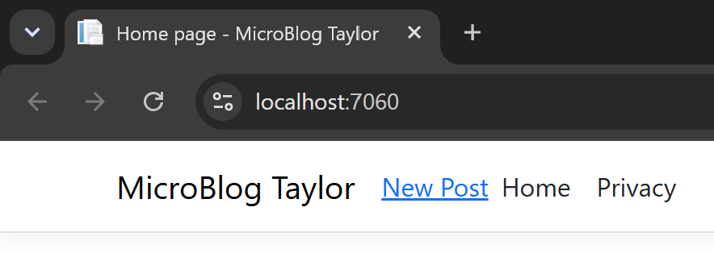
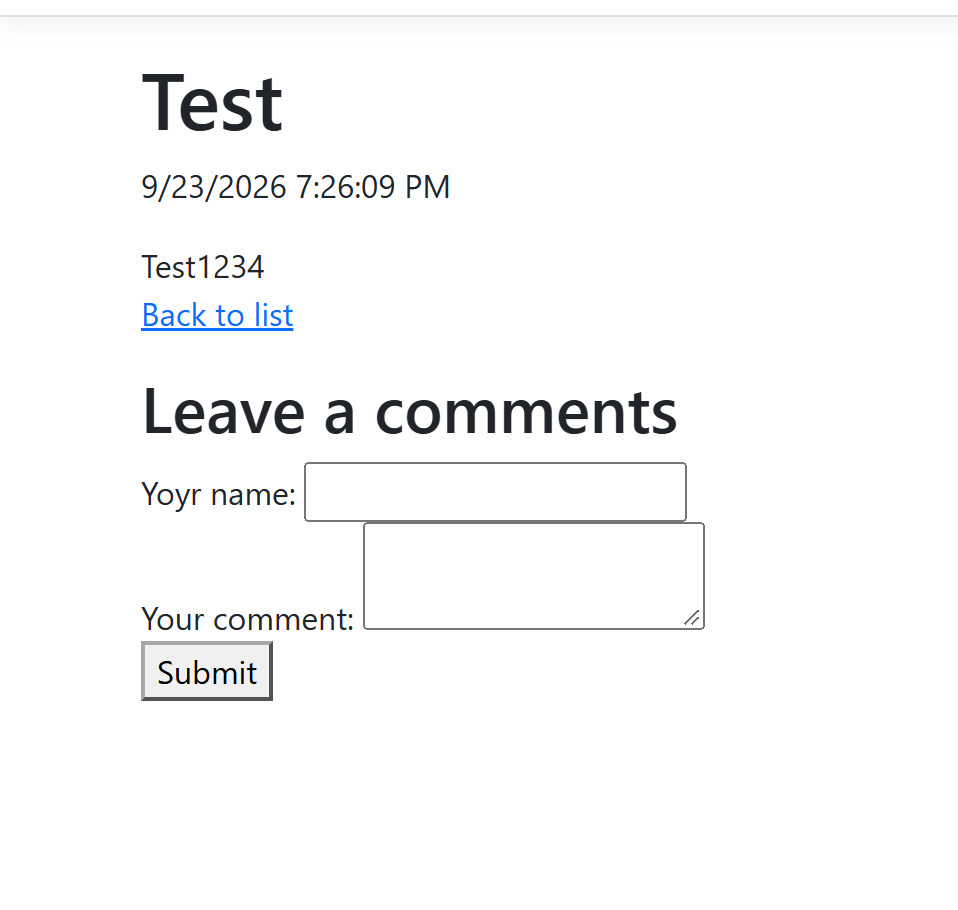
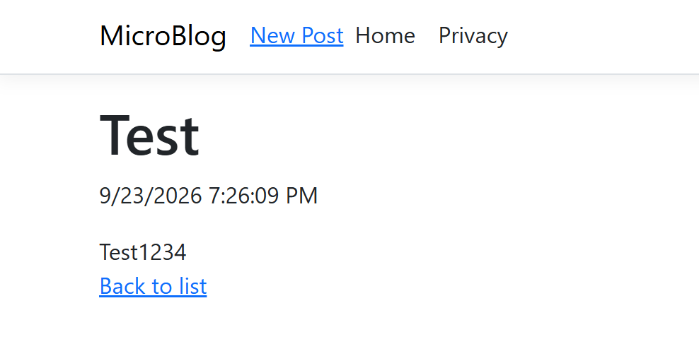
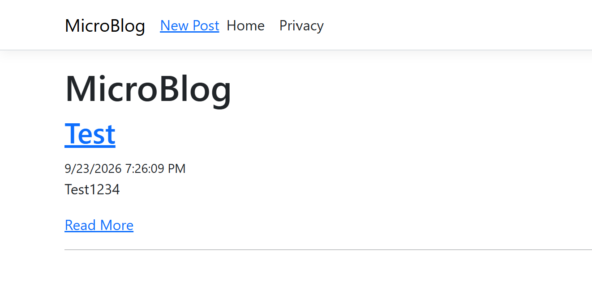
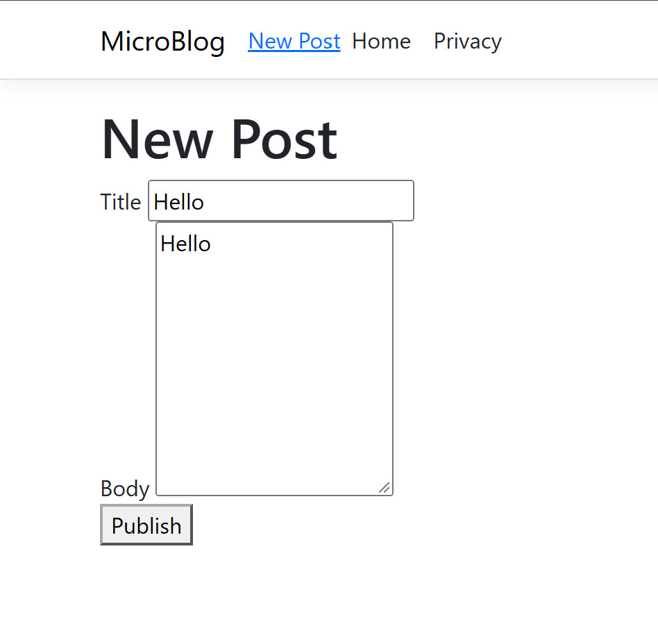

# MicroBlog Configuration

MicroBlog is a small RAZOR web app that allows users to create, view, and navigate posts in a minimalistic blog environment. All posts are stored in .json, and persist through restarts. With this update you can now specify whether or not you would like to display the comments form within the appsettings.json file. It is by default false in the production version due to the comments feature not being fully finished, but it is enabled in appsettings.Developer.json so that it can be worked on more in the future. You can also now change the site name within the appsettings.json file and it will change the name of the site everywhere!

# Configuration Settings

`{
  "SiteOptions": {
    "SiteName": "MicroBlog Taylor",
    "EnableComments":  false
  }
}`

SiteName allows you to change the name of the site. (string)

EnableComments controls whether or not the comments form will be shown when viewing a post. (true/false)

# Images

## Website name changing update example:

## Comments form example:

## Post viewing example:

## Home example:

## Post creation example:

